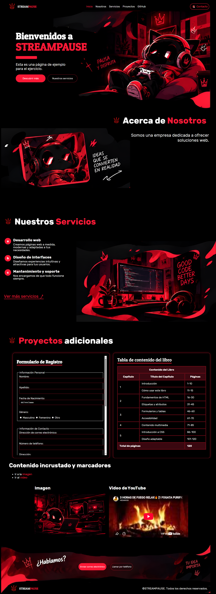

<div align="center">


# STREAMPAUSE


**Tarea trimestral de HTML5: estructura, formularios, tablas y contenido incrustado**

[](https://github.com/estelaV9/DisenioInterfacesWeb/tree/master/Tarea1_PrimeraEvaluacion/streampause)

</div>

---

## Indice
1. [Descripcion del proyecto](#descripcion-del-proyecto)
2. [Estructura de directorios](#estructura-de-directorios)
3. [Ejercicio 1: Estructura basica y enlaces](#ejercicio-1-estructura-basica-y-enlaces-20-puntos)
4. [Ejercicio 2: Formulario de registro](#ejercicio-2-formulario-de-registro-35-puntos)
5. [Ejercicio 3: Tabla de contenido](#ejercicio-3-tabla-de-contenido-25-puntos)
6. [Ejercicio 4: Contenido incrustado y marcadores](#ejercicio-4-contenido-incrustado-y-marcadores-20-puntos)
7. [Rubrica de evaluacion](#rubrica-de-evaluacion)

---

## Descripcion del proyecto
**StreamPause** es la web  desarrollada para resolver los cuatro ejercicios de la tarea

<div align="center">

<br>
<sub>Captura de pantalla completa de la pagina</sub>
</div>

---

## Estructura de directorios
```text
streampause/
├── assets/
│   ├── icon/
│   │   └── mail_icon.png
│   ├── cat_img.png
│   ├── contacto.png
│   ├── footer.png
│   ├── header.png
│   ├── logo.png
│   └── servicios.png
├── doc/
│   └── full_page_streampause.png
├── fonts/
│   └── PatuaOne-Regular.ttf
├── pages/
│   ├── ejercicio2.html
│   ├── ejercicio3.html
│   └── ejercicio4.html
├── secciones/
│   ├── header_nav.html
│   └── proyectos.html
├── ejercicio1.html
└── styles.css
```

| Ruta | Funcion |
| :-- | :-- |
| `ejercicio1.html` | Pagina principal (`index`). Resuelve el Ejercicio 1 e incrusta las secciones |
| `pages/` | Un HTML por cada uno de los ejercicios 2, 3 y 4 |
| `secciones/header_nav.html` | Cabecera y navegacion, cargada por `iframe` en el ejercicio 1 |
| `secciones/proyectos.html` | Titulo y tres `iframe` que muestran los ejercicios 2, 3 y 4 |
| `assets/` | Imagenes usadas en la web |
| `fonts/` | Fuente Patua One para el nombre de la pagina |
| `doc/` | Documentacion: captura de la pagina completa |
| `styles.css` | Estilos de la pagina |

---

## Ejercicio 1: Estructura basica y enlaces (2,0 puntos)
**Archivo:** [`ejercicio1.html`](streampause/ejercicio1.html)

### Enunciado
Crea una pagina web HTML que cumpla con las siguientes especificaciones, conteniendo estas etiquetas.

- `<!DOCTYPE html>`
- `<html lang="es">`
- `<head>` con:
  - `<meta charset="UTF-8">`
  - `<meta name="viewport" content="width=device-width, initial-scale=1.0">`
  - `<title>Mi Pagina Web</title>`
- `<body>` que contenga:
  - `<header>` con:
    - `<h1>Bienvenidos a Mi Pagina Web</h1>`
    - `<p>Esta es una pagina de ejemplo para el ejercicio.</p>`
- **Secciones:** agrega dos secciones a tu pagina:
  - una seccion principal `<main>` con:
    - `<h2>Acerca de Nosotros</h2>`
    - `<p>Somos una empresa dedicada a ofrecer soluciones web.</p>`
  - una seccion `<section>` con:
    - `<h2>Nuestros Servicios</h2>`
    - Una lista ordenada `<ol>` con tres elementos `<li>` que describan los servicios que ofrece tu empresa. Las vinetas deben ser de tipo abecedario.
    - Un enlace `<a>` con el texto "Ver mas servicios" que lleve a `https://www.ejemplo.com`. Abre el enlace en una nueva ventana o pestana del navegador.
- **Pie de pagina:** crea un pie de pagina `<footer>` con dos enlaces:
  - un enlace `<a>` con el texto "Enviar correo electronico" que tenga como href `mailto:info@miempresa.com`
  - un enlace `<a>` con el texto "Llamar por telefono" que tenga `href="tel:+1234567890"`
  - Incluye el caracter especial "&copy;" seguido del nombre de tu empresa para indicar "Todos los derechos reservados". Utiliza entidades, codigo hexadecimal o decimal para incluir el caracter especial.

<div align="center">

</div>

---

## Ejercicio 2: Formulario de registro (3,5 puntos)

**Archivo:** [`pages/ejercicio2.html`](streampause/pages/ejercicio2.html)

### Enunciado
Crea una pagina de registro en HTML que recoja informacion detallada de los usuarios. La pagina debe contener los siguientes campos:

**Informacion personal**
- Nombre (campo de texto, requerido)
- Apellido (campo de texto, requerido)
- Fecha de nacimiento (campo de fecha, requerido)
- Genero (selector de tipo radio: Masculino, Femenino, Otro, requerido)

**Informacion de contacto**
- Direccion de correo electronico (campo de correo electronico, requerido)
- Numero de telefono (campo de telefono, requerido)
- Direccion (campo de texto de varias lineas)

**Informacion de cuenta**
- Nombre de usuario (campo de texto, requerido)
- Contrasena (campo de contrasena, requerido)
- Confirmacion de contrasena (campo de contrasena para confirmar, requerido)

**Preferencias**
- Seleccionar un color favorito (selector de tipo select: Rojo, Azul, Verde, Amarillo)
- Aceptar terminos y condiciones (selector de tipo checkbox, requerido)

Utiliza etiquetas `fieldset` y `legend` para agrupar y describir secciones de formulario. Asegurate de que los campos marcados como "requeridos" deben ser completados antes de enviar el formulario. Enlaza cada etiqueta `<label>` con su campo de entrada correspondiente utilizando los atributos `for` e `id` para mejorar la accesibilidad.


<div align="center">

</div>

---

## Ejercicio 3: Tabla de contenido (2,5 puntos)
**Archivo:** [`pages/ejercicio3.html`](streampause/pages/ejercicio3.html)

### Enunciado
Imagina que estas creando una pagina web para un libro en linea y necesitas crear una tabla de contenido para mostrar los capitulos del libro. Segun sea necesario, debes usar las siguientes etiquetas HTML: `<table>`, `<caption>`, `<tr>`, `<td>`, `<th>`, `<colgroup>`, `<col>`, `<tbody>`, `<thead>`, `<tfoot>`. Y los atributos `rowspan` y `colspan`.

- Crea una tabla `<table>` que contendra la tabla de contenido del libro
- Agrega una fila de encabezado `<thead>` a la tabla con una fila `<tr>`
- En la fila de encabezado, agrega celdas de encabezado `<th>` para las siguientes columnas: Capitulo, Titulo del Capitulo y Paginas
- Utiliza el atributo `colspan` para combinar las tres celdas de encabezado en una sola celda de encabezado que tenga el texto "Contenido del Libro"
- Ahora, agrega tres filas `<tr>` en la seccion del cuerpo `<tbody>` de la tabla para representar los primeros tres capitulos del libro
- Dentro de cada fila, agrega una celda de datos `<td>` para cada columna (Capitulo, Titulo del Capitulo y Paginas). Llena estas celdas con informacion de ejemplo para los primeros tres capitulos del libro
- Utiliza el atributo `rowspan` para combinar las celdas de datos de los capitulos en una sola celda para cada capitulo. Esto indicara cuantas filas ocupa cada capitulo
- Luego, agrega una fila `<tr>` adicional para representar el cuarto capitulo del libro. En este caso, el cuarto capitulo deberia ocupar solo una fila
- Completa la tabla agregando mas filas y celdas de datos para representar mas capitulos del libro, manteniendo la estructura de la tabla de contenido

---

## Ejercicio 4: Contenido incrustado y marcadores (2,0 puntos)
**Archivo:** [`pages/ejercicio4.html`](streampause/pages/ejercicio4.html)

### Enunciado
Crea una pagina web que incluya contenido incrustado y marcadores con las siguientes caracteristicas:

- Utiliza la etiqueta `` para mostrar una imagen en tu pagina. Debes incluir los siguientes atributos:
  - `src`: especifica la URL o la ruta de la imagen que deseas mostrar
  - `alt`: proporciona un texto alternativo para la imagen en caso de que no se cargue correctamente
  - `width`: establece el ancho de la imagen en pixeles
  - `height`: establece la altura de la imagen en pixeles
- Inserta un video de YouTube en tu pagina. Para ello, debes utilizar la etiqueta `<iframe>`. Asegurate de seguir estos pasos:
  - Ve al video de YouTube que deseas insertar
  - Haz clic en el boton "Compartir" debajo del video
  - Selecciona la opcion "Insertar"
  - Copia el codigo HTML proporcionado por YouTube y pegalo en tu pagina
- Agrega un titulo o encabezado a tu pagina utilizando la etiqueta `<h1>`. Elige un titulo relevante para tu pagina
- Utiliza marcadores para crear enlaces internos que permitan a los usuarios navegar rapidamente entre la imagen y el video. Para ello, utiliza la etiqueta `<a>` con el atributo `href` que apunte a los marcadores
- Incluye las etiquetas para la metainformacion, como `<meta name="description" content="Descripcion de la pagina">` y `<meta name="author" content="Tu Nombre">`
- Puedes agregar cualquier otro contenido o texto que desees en tu pagina para darle contexto

<div align="center">

</div>

---

## Rubrica de evaluacion

| Criterio | Insuficiente (1-4) | Suficiente (5-6) | Notable (7-8) | Sobresaliente (9-10) |
| :-- | :-- | :-- | :-- | :-- |
| **Estructura semantica y contenido** (Ej. 1 y 4) | Omite etiquetas semanticas (`header`, `main`, `footer`) o usa etiquetas no validas | Crea la estructura basica correctamente, pero comete errores en atributos de imagenes o enlaces | Estructura el documento con HTML5 semantico impecable e incluye incrustaciones (`iframe`) y metainformacion | Jerarquia semantica perfecta, uso correcto de entidades especiales y marcadores de navegacion interna |
| **Formularios y accesibilidad** (Ej. 2) | No asocia los `label` con los `input` o faltan atributos de validacion (`required`) | Incluye los campos solicitados y valida campos obligatorios, pero olvida agrupar con `fieldset` | Agrupa correctamente con `fieldset` y `legend` y asocia todas las etiquetas `label` mediante `for` e `id` | Formulario perfectamente estructurado, 100% accesible para lectores de pantalla y con tipos de input optimos |
| **Construccion de tablas** (Ej. 3) | La tabla no renderiza correctamente o ignora las secciones `thead` y `tbody` | Construye la tabla con la estructura basica, pero falla en la combinacion de filas o columnas (`rowspan` y `colspan`) | Implementa `thead`, `tbody`, `caption` y aplica correctamente `colspan` y `rowspan` segun las instrucciones | Manejo avanzado de la estructura de tablas, codigo limpio, indentado y con el uso de `colgroup` si aplica |

### Reparto de puntos

| Ejercicio | Contenido | Puntos |
| :-- | :-- | :--: |
| E1 | Estructura basica y enlaces | 2,0 |
| E2 | Formulario de registro | 3,5 |
| E3 | Tabla de contenido | 2,5 |
| E4 | Contenido incrustado y marcadores | 2,0 |
| | **Total** | **10,0** |

---

<div align="center">

### Listo para verlo?

[](https://github.com/estelaV9/DisenioInterfacesWeb/tree/master/Tarea1_PrimeraEvaluacion/streampause)

<sub>StreamPause &middot; 2&ordm; DAW &middot; Desarrollo de Interfaces Web</sub>

</div>

---
>_Estela de Vega Martín | IES Ribera de Castilla 26/27._
